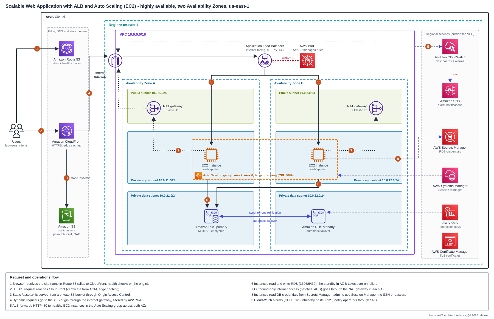

# Scalable, Highly Available Web Application on AWS (ALB + Auto Scaling)

**AWS Certified Solutions Architect – Associate (SAA) graduation project**
Architecture: EC2-based, three-tier, multi-AZ · Region: `us-east-1` · Author: [MarkoSami](https://github.com/MarkoSami)

> **Project status:** this repository is the complete architecture design and documentation for the solution
> (diagram, design decisions, network and security design, deployment guide, validation plan).
> It has **not been deployed** to a live AWS account, so there is no live URL or demo video.

---

## 1. Solution overview

A production-style web application hosted on AWS that stays available when an instance or a whole Availability Zone fails, scales with traffic, and keeps compute and data off the public internet.

**Requirements this design meets**

| # | Requirement | How the design meets it |
|---|---|---|
| R1 | Survive loss of an instance or an entire AZ | Everything runs in two AZs: ALB, Auto Scaling group (ASG), NAT gateways, RDS Multi-AZ |
| R2 | Scale automatically with load | ASG with target tracking on CPU and ALB requests per target |
| R3 | Low latency for users worldwide | CloudFront caches static assets and terminates HTTPS at the edge |
| R4 | No servers reachable from the internet | EC2 and RDS sit in private subnets; only the ALB is internet-facing |
| R5 | Protect against common web attacks | AWS WAF on the ALB with OWASP-focused managed rules and a rate limit |
| R6 | No bastion hosts or SSH keys | Systems Manager Session Manager for shell access |
| R7 | Know when something is wrong | CloudWatch dashboards and alarms notify an SNS topic |
| R8 | Durable, recoverable data | RDS Multi-AZ with synchronous replication, automated backups, encryption |

## 2. Architecture diagram

*Editable source: [`docs/diagrams/architecture.dot`](docs/diagrams/architecture.dot) (Graphviz).
Regenerate with `dot -Tsvg docs/diagrams/architecture.dot -o docs/diagrams/architecture.svg` (or `-Tpng`).*

### Request flow

1. A user looks up the site name. **Route 53** returns an alias to the **CloudFront** distribution.
2. The user connects to CloudFront over HTTPS.
3. Requests for `/assets/*` are served from the CloudFront cache, backed by a private **S3** bucket (Origin Access Control).
4. All other requests are forwarded to the **Application Load Balancer** (the origin, addressed through a Route 53 alias with a health check), passing through the **Internet Gateway**. **AWS WAF** inspects the request at the ALB.
5. The ALB forwards healthy requests to **EC2 instances in private subnets** in either AZ.
6. The application reads and writes **Amazon RDS** (Multi-AZ). Credentials come from **Secrets Manager**.
7. Instances reach the internet for patches through the **NAT gateway in their own AZ**, and reach S3 through a **gateway VPC endpoint** (no NAT data charges for S3 traffic).
8. **CloudWatch** collects metrics from the ALB, ASG and RDS. Alarms publish to **SNS**.

## 3. AWS services and their role

| Service | Purpose in this design | Key configuration |
|---|---|---|
| **VPC** | Network isolation | `10.0.0.0/16`, 2 AZs, 6 subnets (public, private-app, private-data), route tables, NAT gateways, security groups, NACLs |
| **EC2 + Auto Scaling** | Elastic compute | Launch Template (Amazon Linux 2023, IMDSv2 required), min 2 / desired 2 / max 6, ELB health checks, target tracking |
| **Application Load Balancer** | Layer 7 load balancing | HTTPS listener (ACM certificate), HTTP→HTTPS redirect, health check path `/health`, cross-zone enabled |
| **AWS WAF** | Web attack protection | AWS managed Core rule set, Known bad inputs, SQL database rules, rate-based rule |
| **CloudFront** | Global caching and TLS at the edge | Two origins (S3 and ALB), two cache behaviors, redirect HTTP to HTTPS |
| **Amazon S3** | Static asset storage | Block Public Access on, versioning on, SSE enabled, bucket policy only allows CloudFront (OAC) |
| **Amazon RDS (MySQL or PostgreSQL)** | Relational database | Multi-AZ, gp3 storage, encryption with KMS, 7-day automated backups, deletion protection |
| **Route 53** | DNS and health checks | Alias A record to CloudFront; alias to ALB for the origin name with a health check |
| **Systems Manager** | Secure instance access and patching | Session Manager with `AmazonSSMManagedInstanceCore` instance role; no inbound SSH |
| **Secrets Manager** | Database credentials | RDS-managed master password, automatic rotation |
| **CloudWatch + SNS** | Observability and alerting | Dashboard, alarms (section 7), email subscription on the SNS topic |
| **ACM** | TLS certificates | One certificate for CloudFront, one for the ALB, both in `us-east-1` |
| **IAM / KMS** | Least privilege and encryption | Instance role with only SSM and Secrets read permissions; KMS key for RDS and EBS |

## 4. Network design

**CIDR plan**

| Subnet | AZ | CIDR | Route to internet | Contains |
|---|---|---|---|---|
| public-a | us-east-1a | `10.0.1.0/24` | Internet Gateway | ALB node, NAT gateway A |
| public-b | us-east-1b | `10.0.2.0/24` | Internet Gateway | ALB node, NAT gateway B |
| private-app-a | us-east-1a | `10.0.11.0/24` | NAT gateway A (outbound only) | EC2 instances |
| private-app-b | us-east-1b | `10.0.12.0/24` | NAT gateway B (outbound only) | EC2 instances |
| private-data-a | us-east-1a | `10.0.21.0/24` | None | RDS primary |
| private-data-b | us-east-1b | `10.0.22.0/24` | None | RDS standby |

**Route tables:** one public table (`0.0.0.0/0` → Internet Gateway), one private-app table per AZ (`0.0.0.0/0` → that AZ's NAT gateway, plus the S3 gateway endpoint), one data table with local routes only.

**Security groups (chained by reference, not by IP)**

| Security group | Inbound | Source |
|---|---|---|
| `sg-alb` | TCP 443 (and 80 for redirect) | Internet, or the CloudFront origin-facing managed prefix list to force traffic through CloudFront |
| `sg-app` | TCP 80 | `sg-alb` only |
| `sg-db` | TCP 3306 (MySQL) or 5432 (PostgreSQL) | `sg-app` only |
| VPC endpoints (if used for SSM) | TCP 443 | `sg-app` |

**NACLs:** stateless second layer. The data-subnet NACL only allows the DB port from the app subnets and ephemeral return ports. The app-subnet NACL only allows HTTP from the public subnets.

**Locking the origin to CloudFront (recommended hardening):** restrict `sg-alb` to the CloudFront managed prefix list and add an ALB listener rule that requires a secret custom header (for example `X-Origin-Verify`) added by CloudFront, so the ALB cannot be reached directly.

## 5. Security design

| Layer | Control |
|---|---|
| Edge | HTTPS only, TLS 1.2+ policy, WAF managed rules, rate-based rule against abuse |
| Network | Compute and data in private subnets, security-group chaining, NACLs, no public IPs on instances |
| Access | No SSH and no bastion: Session Manager with IAM-controlled, CloudTrail-logged sessions |
| Identity | Instance role with least privilege (SSM core + read of the one DB secret), IMDSv2 enforced |
| Data at rest | KMS-encrypted RDS and EBS volumes, SSE on S3 |
| Data in transit | TLS from client to CloudFront and ALB; enforce SSL on the database connection |
| Secrets | No credentials in code or AMIs; Secrets Manager with rotation |
| Audit | CloudTrail enabled, ALB access logs to an S3 log bucket |

## 6. High availability and scaling

| Failure or event | What happens | Recovery |
|---|---|---|
| EC2 instance fails health check | ALB stops routing to it; ASG terminates and replaces it | Automatic, minutes |
| Entire AZ unavailable | ALB serves from the surviving AZ; ASG launches capacity there; RDS promotes the standby | Automatic; RDS failover is typically 1 to 2 minutes |
| RDS primary fails | Multi-AZ fails over to the standby; the DNS endpoint is unchanged | Automatic |
| Traffic spike | Target tracking adds instances (CPU target 50%, requests per target target) up to max 6 | Automatic |
| Traffic falls | ASG scales in to the minimum of 2 | Automatic |
| Web attack (SQLi, XSS, floods) | WAF blocks matching requests before they reach instances | Automatic |
| Whole-Region outage | Out of scope for this design; see "Future improvements" | Manual |

**Scaling policy details:** target tracking on `ASGAverageCPUUtilization` = 50% and `ALBRequestCountPerTarget`; instance warm-up 120 s; health check grace period 300 s; scale-in protection not used because instances are stateless (sessions kept out of local disk).

## 7. Monitoring and alerting

| Alarm | Metric | Condition | Action |
|---|---|---|---|
| ALB 5xx errors | `HTTPCode_ELB_5XX_Count` / target 5xx | Above threshold for 2 of 3 periods | SNS |
| Unhealthy hosts | `UnHealthyHostCount` | ≥ 1 for 3 minutes | SNS |
| Slow responses | `TargetResponseTime` p90 | Above 1 s for 5 minutes | SNS |
| ASG at max capacity | `GroupInServiceInstances` vs max | Equal to max for 15 minutes | SNS |
| RDS CPU | `CPUUtilization` | Above 80% for 10 minutes | SNS |
| RDS storage | `FreeStorageSpace` | Below 20% of allocated | SNS |
| RDS connections | `DatabaseConnections` | Near the instance limit | SNS |
| Origin health | Route 53 health check status (`us-east-1`) | Unhealthy | SNS |

A CloudWatch dashboard shows request count, latency, 4xx/5xx, healthy hosts, ASG size, CPU, and RDS CPU, connections and free storage. The CloudWatch agent on the instances adds memory and disk metrics.

## 8. Well-Architected Framework mapping

| Pillar | How it is addressed |
|---|---|
| Operational excellence | Launch Template and ASG for repeatable instances, Session Manager, dashboards and alarms, deployment guide with cleanup steps |
| Security | Defense in depth (section 5), private subnets, least privilege, encryption, WAF |
| Reliability | Multi-AZ at every tier, health checks at ALB, ASG and Route 53, automated failover and backups |
| Performance efficiency | CloudFront edge caching, ALB request-based scaling, right-sized instances with gp3 storage |
| Cost optimization | Auto Scaling scales in off-peak, CloudFront offloads origin traffic, S3 gateway endpoint avoids NAT data charges for S3, Savings Plans or Reserved Instances for the steady baseline |
| Sustainability | Scale to demand, managed services, right-sizing |

## 9. Cost considerations

Prices vary by region and change over time, so use the [AWS Pricing Calculator](https://calculator.aws/) to estimate this architecture. The main cost drivers, roughly from largest to smallest for a small deployment:

1. **NAT gateways** (hourly charge per AZ plus data processed). Two are used for AZ fault isolation. A single NAT gateway is a cheaper dev/test option that accepts a single-AZ dependency for outbound traffic.
2. **RDS Multi-AZ** (roughly double a single-AZ instance).
3. **EC2 instances** (minimum 2 running at all times).
4. **Application Load Balancer** (hourly plus capacity units).
5. **AWS WAF** (per web ACL, per rule, per request).
6. **CloudFront, S3, CloudWatch, Route 53** (usage based, usually small).

## 10. Deployment guide and validation

Step-by-step build instructions, a test plan (load test, instance termination, RDS failover, WAF test) and a cleanup order are in [`docs/deployment-guide.md`](docs/deployment-guide.md).

## 11. Learning outcomes demonstrated

- Designed a VPC with correct public, private and data subnets, route tables and NAT gateways across two AZs
- Built a highly available architecture with Multi-AZ RDS, an ASG across two AZs and an ALB
- Configured ALB listener rules and target group health checks
- Implemented Auto Scaling with target tracking policies
- Secured the application with WAF, security-group chaining, private subnets and encryption
- Used Systems Manager Session Manager as a bastion-free access method

## 12. Limitations and future improvements

- **Not deployed:** the design has not been built in a live account, so no performance figures or screenshots are included.
- **Single Region:** a Region-wide outage is out of scope. A natural extension is a warm-standby second Region with Aurora Global Database, S3 Cross-Region Replication and Route 53 failover routing.
- **Infrastructure as code:** the build is documented as console and CLI steps; a CloudFormation or Terraform template would make it repeatable.
- **Read scaling:** add RDS read replicas or ElastiCache if the workload becomes read-heavy.
- **Edge WAF:** attach WAF at CloudFront as well, and add AWS Shield Advanced if DDoS protection is required.

## License

[MIT](LICENSE)
